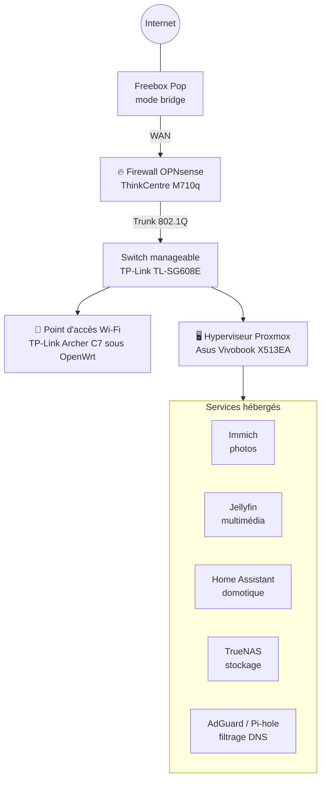
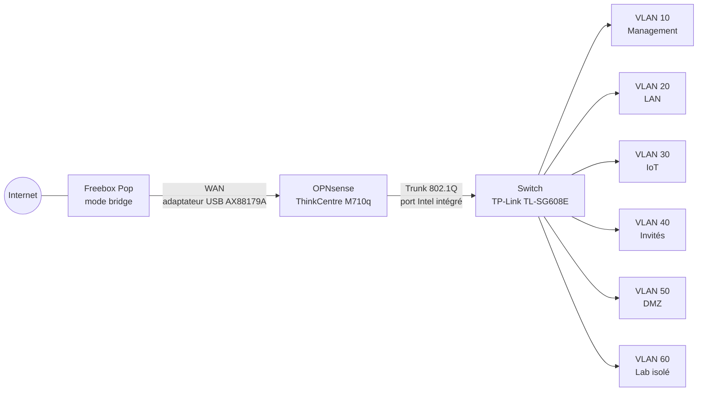

# 📓 Journal de bord — Homelab

> Conception, sécurisation et documentation d'une infrastructure réseau complète à domicile, avec un budget maîtrisé.

---

## 👋 Présentation

Ce journal retrace le projet de homelab de **[Prénom]**, étudiant en 4ᵉ année d'ingénieur en sécurité et qualité des réseaux à **[École]**.

Le projet est né d'une envie simple : **apprendre en mettant en pratique** les notions vues en cours sur une infrastructure réelle, conçue, installée et administrée de bout en bout. Il fera l'objet d'une présentation lors de la soutenance de fin d'année, mais il est avant tout mené par intérêt personnel pour le réseau et la sécurité.

---

## 🎯 Objectifs

- **Sécuriser** : un firewall dédié, une segmentation du réseau en VLAN et l'application du principe du moindre privilège entre les segments.
- **Héberger soi-même ses services** : photos, multimédia, domotique, stockage et filtrage DNS, sans dépendre de services tiers.
- **Apprendre et documenter** : chaque choix est justifié, chaque compromis est assumé, chaque erreur est consignée avec sa solution.

---

## 🗺️ Architecture cible

Le schéma ci-dessous représente l'objectif à terme. Il évoluera au fil du projet.



L'ensemble prendra place dans un **mini rack 10"** imprimé en 3D au fablab de l'école.

---

## 📖 Comment lire ce journal

- **Organisation par thèmes** : chaque chapitre couvre un élément du homelab, de l'achat jusqu'à la mise en service. La chronologie se lit dans l'historique des commits.
- **Documentation technique** : les procédures pas à pas se trouvent dans le dossier [`docs/`](docs/). Ce journal se concentre sur le *pourquoi* et le déroulé du projet.
- **Version anglaise** : un README en anglais présentera le projet de façon synthétique.
- **Confidentialité** : les informations sensibles (IP publique, mots de passe, adresses MAC, exports de configuration) sont volontairement absentes ou anonymisées.

---

## 📑 Sommaire

| Chapitre | Statut |
|---|---|
| [🔥 Firewall — OPNsense](#-firewall--opnsense) | En cours |
| 🔀 Switch et VLAN | 🕓 |
| 📶 Wi-Fi — OpenWrt | 🕓 |
| 🖥️ Proxmox | 🕓 |
| 🧩 Services | 🕓 |
| 🗄️ Rack | 🕓 |

---

## 💰 Budget

| Chapitre | Montant | Détail |
|---|---|---|
| 🔥 Firewall | 70 € | ThinkCentre M710q (55 €) ✅ + adaptateur USB-A → RJ45 (15 €) |
| 🔀 Switch et VLAN | *à compléter* | |
| 📶 Wi-Fi | *à compléter* | |
| 🖥️ Proxmox | 15 € | Adaptateur USB-C → RJ45 (15 €) |
| 🧩 Services | *à compléter* | |
| 🗄️ Rack | *à compléter* | |
| **Total** | **85 €** | *mis à jour au fil du projet* |

---


## 🔥 Firewall — OPNsense


### 1. En bref

Le firewall est la porte d'entrée du homelab : toute communication entre Internet et le réseau de l'appartement passe par lui. Il repose sur un mini PC **Lenovo ThinkCentre M710q Tiny** reconditionné, acheté 55 €, qui fait tourner **OPNsense**. L'architecture retenue associe un **WAN physiquement séparé** et un **Router-on-a-Stick côté LAN** pour router et filtrer six VLAN. La Freebox Pop passe en mode bridge et ne fait plus que relier le réseau à la fibre.

---

### 2. Besoin et contexte

Dans une installation classique, la box de l'opérateur fait tout à la fois : modem, routeur, Wi-Fi et pare-feu basique. Tous les appareils se retrouvent sur un même réseau à plat et peuvent communiquer librement entre eux. Si un objet connecté est compromis, l'attaquant peut alors rebondir vers le reste du réseau.

L'objectif est de reprendre la main sur le réseau avec un équipement dédié capable de :

- **router** le trafic entre Internet et le réseau interne, et entre les différents segments internes ;
- **filtrer** ce trafic selon des règles explicites, en appliquant le principe du moindre privilège ;
- **segmenter** le réseau en VLAN (*Virtual LAN*, des réseaux logiques isolés qui partagent le même matériel physique) ;
- servir plus tard de socle à la **détection d'intrusion** (IDS) et au **VPN**.

Le firewall remplace donc la fonction de routeur de la Freebox Pop, qui passe en **mode bridge**. Dans ce mode, la box se contente de faire le lien entre la fibre et le réseau, sans routage, sans DHCP et sans Wi-Fi.

---

### 3. Choix et alternatives écartées

#### 3.1 Le logiciel : OPNsense plutôt que pfSense

OPNsense est né en 2015 d'un fork de pfSense. Les deux reposent sur **FreeBSD**, un système d'exploitation libre de la famille Unix réputé pour la solidité de sa pile réseau. pfSense CE est lui aussi open source : l'open source n'est donc pas, à lui seul, un critère de différenciation. Le choix d'OPNsense repose sur les points suivants :

| Critère | OPNsense | pfSense |
|---|---|---|
| Modèle de distribution | Une seule édition, entièrement open source | Édition CE open source, et pfSense Plus propriétaire mise en avant par l'éditeur |
| Mises à jour | Cycle régulier, correctifs de sécurité fréquents | Évolution de la version CE plus lente |
| Interface | Moderne, intuitive, API complète | Plus datée |
| Plugins utiles au projet | WireGuard, Suricata, Unbound intégrés | Disponibles également |

Pour un équipement exposé en permanence à Internet, la fréquence des correctifs de sécurité est le critère déterminant.

#### 3.2 La machine : ThinkCentre M710q Tiny

| Composant | Caractéristique | Intérêt pour un firewall |
|---|---|---|
| CPU | Intel Celeron G3900T : 2 cœurs / 2 threads, AES-NI, TDP 35 W | **AES-NI** : instructions qui accélèrent matériellement le chiffrement, utiles pour le VPN. **TDP 35 W** : gamme basse consommation, adaptée à un fonctionnement 24/7 |
| RAM | 8 Go (2 × 4 Go) | Largement suffisant pour OPNsense, avec de la marge pour Suricata |
| Stockage | SSD NVMe 250 Go | Un SSD supporte les écritures continues de logs |
| Format | Tiny | Compact, silencieux, compatible avec un mini rack 10" |
| Origine | Matériel professionnel reconditionné | Plateforme robuste et très répandue dans la communauté homelab |

**Limite assumée :** avec 2 cœurs, le processeur gère confortablement le routage et le filtrage, mais il pourrait devenir le goulot d'étranglement si Suricata est un jour activé en mode bloquant (voir *Perspectives*).

**HDD de 500 Go retiré.** La machine a été livrée avec un disque dur mécanique en plus du NVMe. Il a été retiré : OPNsense n'en a pas besoin, et une pièce mécanique ajoute de la consommation, de la chaleur et un risque de panne dans une machine allumée en permanence. Le disque est conservé pour un usage futur, par exemple des sauvegardes.

#### 3.3 La deuxième carte réseau

Un firewall a besoin d'au moins deux interfaces réseau (NIC : Network Interface Card) distinctes, une côté Internet (**WAN**) et une côté réseau interne (**LAN**). Le M710q ne possède qu'un seul port RJ45, et uniquement des ports USB-A. Il faut donc ajouter une carte réseau USB.

Sur FreeBSD, la compatibilité matérielle est plus restreinte que sur Linux, et c'est la **puce** de l'adaptateur qui compte, pas la marque.

| | Retenu ✅ | Écarté ❌ |
|---|---|---|
| Modèle | UGREEN USB-A → RJ45, 1 Gbps | UGREEN USB-A → RJ45, 2,5 Gbps |
| Puce | ASIX AX88179A | Realtek RTL8156BG |
| Support FreeBSD | Driver `axge`, AX88179A supporté depuis FreeBSD 13 | Retours de stabilité plus mitigés sur les puces Realtek USB |
| Prix | 15 € | 30 € |

**Pourquoi ne pas prendre le 2,5 Gbps ?** La Freebox Pop peut délivrer jusqu'à 2,5 Gbps sur un seul appareil (5 Gbps partagés entre ses ports, 900 Mbps en envoi). Mais le débit d'une chaîne réseau est celui de son maillon le plus lent. Ici, tout le trafic ressort par le port Intel du Tiny (1 Gbps), traverse le switch (ports 1 Gbps), et le Celeron ne saurait de toute façon pas router et filtrer 2,5 Gbps. Un WAN à 2,5 Gbps n'apporterait donc aucun gain tant que le reste de la chaîne reste en Gigabit. Pour une interface WAN, dont la défaillance coupe Internet pour tout l'appartement, **la stabilité prime sur le débit**.

**Compromis assumé :** l'ensemble de l'appartement partage un lien d'environ 940 Mbps utiles, au lieu d'environ 2 Gbps possibles sur un seul appareil branché directement sur la box. En pratique, l'écart reste invisible : le Wi-Fi et la plupart des appareils plafonnent en dessous de 1 Gbps, et le débit montant (900 Mbps) tient dans le lien Gigabit. Une petite part de débit théorique, non exploité, est échangée contre le contrôle total du réseau.

#### 3.4 Pourquoi l'adaptateur USB sert de WAN, et non de LAN

C'est un choix structurant, qui repose sur quatre arguments :

1. **Contrainte technique.** Le driver `axge` ne gère pas le *tagging* VLAN matériel. Or le lien LAN sera un **trunk 802.1Q**, c'est-à-dire un câble unique qui transporte plusieurs VLAN en ajoutant à chaque trame une étiquette indiquant son VLAN. Ce rôle revient donc naturellement au port Intel intégré, dont le driver est plus mature et mieux supporté.
2. **Charge de travail.** En Router-on-a-Stick, tout le trafic inter-VLAN entre et ressort par le lien LAN. C'est le lien le plus sollicité, il doit donc reposer sur l'interface la plus fiable. Le WAN, lui, ne porte qu'un lien simple, sans étiquette, vers la Freebox.
3. **Résilience.** Si l'adaptateur USB tombe en panne, seul l'accès à Internet est coupé. Le réseau interne (VLAN, DNS, services Proxmox) continue de fonctionner.
4. **Maintenance.** Un adaptateur USB se remplace en quelques secondes et pour une quinzaine d'euros, sans ouvrir la machine.

#### 3.5 L'architecture : Router-on-a-Stick côté LAN et WAN séparé

Le **Router-on-a-Stick (ROAS)** consiste à relier le routeur au switch par un seul lien trunk et à créer, sur le routeur, une **sous-interface** par VLAN. Chaque sous-interface sert de passerelle à son VLAN, et le routeur se charge du routage **et du filtrage** entre VLAN.



**Plan de VLAN :**

| ID | Nom | Rôle |
|---|---|---|
| 10 | Management | Administration des équipements (firewall, switch, hyperviseur) |
| 20 | LAN | Postes et appareils personnels de confiance |
| 30 | IoT | Objets connectés, isolés du reste |
| 40 | Invités | Accès Internet uniquement |
| 50 | DMZ | Services potentiellement exposés |
| 60 | Lab isolé | Environnement de test, sans route vers les autres VLAN |

> [!NOTE]
> La configuration des ports du switch (trunk ou access) est documentée dans le chapitre **Switch**. Ce chapitre couvre la partie OPNsense : sous-interfaces, passerelles, DHCP et règles de filtrage inter-VLAN. Le DNS (AdGuard ou Pi-hole sur Proxmox) est traité dans le chapitre **Proxmox**.

---

#### 3.6 Le système de fichiers : ZFS plutôt qu'UFS

Un système de fichiers définit la façon dont les données sont organisées et écrites sur le disque. L'installateur d'OPNsense en propose deux :

| | UFS | ZFS |
|---|---|---|
| Âge | Système historique de FreeBSD | Système moderne |
| Coupure de courant | Risque de corruption si elle survient pendant une écriture | Écrit les nouvelles données à côté des anciennes avant de valider (*copy-on-write*) : le disque reste cohérent |
| Intégrité des données | Pas de vérification | Chaque bloc porte une somme de contrôle : la corruption silencieuse est détectée |
| Snapshots | Non | Oui : retour arrière possible après une mise à jour ratée |
| Ressources | Très léger | Plus gourmand en RAM, mais 8 Go suffisent largement |

ZFS a été retenu pour deux raisons concrètes : la **résistance aux coupures de courant**, essentielle en l'absence d'onduleur, et les **snapshots**, qui permettent de revenir en arrière en quelques minutes avant une mise à jour majeure.

**Limite :** avec un seul disque, ZFS ne protège pas contre une panne du NVMe lui-même, ce qui demanderait un second disque en miroir. L'export régulier de la configuration reste donc indispensable.

---

### 4. Achat

| Élément | Source | Prix | 
|---|---|---|
| Lenovo ThinkCentre M710q Tiny (G3900T, 8 Go, NVMe 250 Go) | Leboncoin | 55,00 € |
| Adaptateur UGREEN USB-A → RJ45 1 Gbps (AX88179A) | Amazon | 15 € |
| **Total** | | **70 €** | |

<!-- Photos à ajouter :

-->

**Vérifications à la réception **

- Démarrage correct sous le Windows préinstallé.
- BIOS accessible et **non verrouillé** par un mot de passe administrateur. C'est un point à vérifier systématiquement sur du matériel d'entreprise reconditionné : sans accès au BIOS, impossible de démarrer sur une clé USB pour installer OPNsense.
- Ouverture du boîtier : intérieur en très bon état, sans poussière excessive ni trace d'oxydation.
- Retrait du HDD de 500 Go.


### 5. Mise en œuvre

> Procédure détaillée, pas à pas : [docs/02-firewall-opnsense.md](docs/02-firewall-opnsense.md)

#### 5.1 Préparation 

**IPv4 fullstack.** Faute d'adresses IPv4 disponibles, Free partage souvent une même adresse IPv4 publique entre plusieurs abonnés, chacun ne recevant qu'une plage de ports. Par exemple, avec une adresse fictive :

| Abonné | Adresse publique | Ports attribués |
|---|---|---|
| Abonné A | 203.0.113.42 | 0 → 16 383 |
| Abonné B | 203.0.113.42 | 16 384 → 32 767 |
| Abonné C | 203.0.113.42 | 32 768 → 49 151 |
| Abonné D | 203.0.113.42 | 49 152 → 65 535 |

Avec une IP partagée, c'est la Freebox qui restreint les connexions à la bonne plage de ports. En mode bridge, elle ne joue plus ce rôle : OPNsense utiliserait des ports hors de la plage et la connexion ne fonctionnerait pas correctement. **Le mode bridge suppose donc une IPv4 fullstack**, c'est-à-dire une adresse dédiée avec l'ensemble de ses 65 535 ports.

La demande se fait gratuitement depuis l'espace abonné Free. Elle est irréversible : il n'est plus possible de revenir à une IP partagée, ce qui ne présente aucun intérêt ici. Le changement a été vérifié de deux façons : l'option apparaît comme active dans l'espace abonné, Freebox OS affiche la nouvelle adresse sans restriction de ports. Avantages supplémentaires : l'adresse est fixe, et le port standard de WireGuard sera utilisable plus tard.

🔗 [En savoir plus sur l'IPv4 fullstack chez Free](https://www.mon-ip.fr/ip-fixe-v4-full-stack-free-guide/)

**Image d'installation.** L'image *vga* d'OPNsense 26.7, prévue pour une installation depuis une clé USB, a été téléchargée puis vérifiée par sa somme de contrôle SHA-256, sous Windows avec PowerShell :

```powershell
(Get-FileHash .\OPNsense-26.7-vga-amd64.img.bz2 -Algorithm SHA256).Hash -eq "<hash officiel>"
# Résultat : True
```

Cette vérification garantit l'**intégrité** du fichier : il n'a pas été altéré pendant le téléchargement. Elle ne garantit pas son **authenticité** : si le miroir de téléchargement était compromis, un attaquant pourrait modifier à la fois l'image et le fichier de hash. Pour prouver l'authenticité, OPNsense fournit aussi une signature à vérifier avec sa clé publique. 

**Plan de retour arrière.** L'application Freebox Connect a été installée sur le téléphone. En mode bridge, l'interface de la Freebox peut devenir difficile à joindre, et l'application permet alors de changer de mode ou de redémarrer la box depuis le réseau mobile.

#### 5.2 Configuration du BIOS 

| Réglage | Valeur | Raison |
|---|---|---|
| Secure Boot | Désactivé | L'installateur d'OPNsense ne démarre pas avec |
| After Power Loss | Power On | Après une coupure de courant, le firewall redémarre seul. Sans ce réglage, tout l'appartement reste sans Internet jusqu'à une intervention manuelle |
| Mot de passe Administrator | Défini | Empêche une personne ayant un accès physique de modifier les réglages ou de démarrer un autre système |
| Mot de passe Power-On | **Non défini** | Il bloquerait le démarrage sur l'écran de saisie après chaque coupure de courant, ce qui annulerait le réglage *After Power Loss* |
| Ordre de démarrage | NVMe uniquement, démarrage USB désactivé | Empêche une personne ayant un accès physique d'altérer le système |

Le mot de passe BIOS se contourne en ouvrant le boîtier pour réinitialiser la mémoire CMOS : c'est une couche de défense supplémentaire, sans coût, et non une protection absolue. C'est le principe de la **défense en profondeur**. Il suffira de le retirer avant une éventuelle revente.

#### 5.3 Installation d'OPNsense 

| Étape | Choix |
|---|---|
| Disposition du clavier | French (AZERTY) |
| Mode d'installation | Install (ZFS) |
| Type de pool ZFS | *stripe* (un seul disque) |
| Disque cible | NVMe 250 Go |
| Mot de passe root | Défini, stocké dans un gestionnaire de mots de passe |

**Assignation des interfaces** depuis la console :

| Rôle | Interface | Matériel | Adresse |
|---|---|---|---|
| WAN | `ue0` | Adaptateur USB AX88179A | Reçue en DHCP de la Freebox (192.168.1.x) |
| LAN | `em0` | Port Intel intégré | `192.168.10.1/24`, serveur DHCP de `.100` à `.200` |

**Pourquoi `192.168.10.1` et pas l'adresse par défaut ?** Par défaut, OPNsense configure son LAN en `192.168.1.1/24`. Or, pendant la phase de préparation, le WAN est branché sur la Freebox, qui distribue elle aussi des adresses en `192.168.1.x`. Avec le même réseau des deux côtés, OPNsense ne pourrait plus distinguer l'intérieur de l'extérieur. L'adresse du LAN a donc été changée. C'est une adresse **temporaire** : le plan d'adressage définitif sera défini avec les VLAN.

#### 5.4 Méthode de bascule en trois temps

Passer la Freebox en mode bridge lui retire son rôle de routeur. Si OPNsense n'est pas prêt à ce moment-là, tout l'appartement perd l'accès à Internet. La migration suit donc trois temps :

| Étape | Description | Statut |
|---|---|---|
| **1. Préparation** | Le WAN du Tiny est branché sur la Freebox, qui reste en mode routeur : c'est un **double NAT temporaire**. OPNsense peut ainsi se mettre à jour et installer ses plugins, pendant que la Freebox continue de servir l'appartement. Toute la configuration se fait depuis un PC branché directement sur le port LAN du Tiny. | En cours |
| **2. Bascule** | Passage de la Freebox en mode bridge, WAN branché sur le port 2,5 Gbps de la Freebox, puis tests de connectivité. Mise en service en IPv4 uniquement dans un premier temps. Aucun impact sur les services Free : ni TV ni téléphonie utilisées. | En attente |
| **3. Plan de retour arrière** | Le mode bridge est réversible. En cas d'échec : retour en mode routeur via Freebox Connect, ou via un PC branché directement sur la Freebox. En dernier recours, une réinitialisation usine de la Freebox. | Préparé  |


#### 5.5 Stabilisation du lien WAN 

Lors de la première session de configuration, le lien WAN coupait plusieurs fois par seconde, ce qui rendait la connexion lente puis inexistante. Après diagnostic (détaillé dans la section 6), la cause était un bug connu du pilote FreeBSD `axge` avec la puce AX88179A.

**Le contournement.** L'adaptateur sait se présenter au système de deux façons :

| Configuration USB | Présentation | Pilote FreeBSD |
|---|---|---|
| 0 (par défaut) | Puce ASIX AX88179A | `axge`, spécifique, instable avec cette puce |
| 1 | Carte réseau USB standard (norme CDC Ethernet) | `cdce`, générique et stable |

La commande `usbconfig -d <périphérique> set_config 1` bascule l'adaptateur en configuration 1. Aucun pilote externe n'est installé : `cdce` fait déjà partie de FreeBSD.

**L'automatisation.** Ce réglage ne survit pas au redémarrage. Il est donc réappliqué automatiquement par **devd**, le service FreeBSD qui réagit aux branchements de périphériques :

- une règle (`/usr/local/etc/devd/axge-cdce.conf`) détecte l'apparition de l'adaptateur grâce à ses identifiants USB (fabricant `0x0b95`, modèle `0x1790`) ;
- elle lance un script (`/usr/local/sbin/axge-to-cdce.sh`) qui bascule l'adaptateur en configuration 1, sauf s'il l'est déjà, et consigne l'action dans les journaux système.

La bascule fonctionne ainsi au démarrage comme lors d'un débranchement de l'adaptateur. Le contenu exact des deux fichiers est disponible dans [docs/02-firewall-opnsense.md](docs/02-firewall-opnsense.md).

**Résultat mesuré** (en double NAT, à travers la Freebox puis OPNsense) :

| Mesure | Valeur |
|---|---|
| Débit descendant | 743 Mbps |
| Débit montant | 871 Mbps |
| Latence | 14 ms |
| Coupures | Aucune |

Le débit reste proche du maximum pratique d'un lien Gigabit (environ 940 Mbps) et du débit montant du forfait (900 Mbps). Le passage par `cdce` n'a donc pas de coût de performance visible ici.

#### 5.6 Mise à jour et configuration de base 

**Snapshots ZFS.** Avant chaque étape sensible, un snapshot du système a été créé depuis *System → Snapshots* :

| Snapshot | Moment |
|---|---|
| `post-install` | Juste après l'installation |
| `wan-cdce-ok` | Après la validation du correctif `cdce` |
| Snapshot post-mise à jour | Après le passage en 26.7.6 |

Un snapshot ZFS est un environnement de démarrage complet : en cas de problème, il suffit de l'activer et de redémarrer pour retrouver l'état exact du système à ce moment-là. Comme les snapshots sont stockés sur le même disque, ils ne remplacent pas une sauvegarde externe de la configuration.

**Mise à jour.** Le système est passé de la version 26.7 à la version **26.7.6** depuis *System → Firmware*. Une première tentative avait échoué silencieusement à cause des coupures du lien WAN. Le contournement `cdce` est resté actif après la mise à jour.

**Assistant de configuration** (*System → Wizard*) :

| Paramètre | Valeur | Justification |
|---|---|---|
| Domaine | `internal` | Domaine réservé par l'ICANN (Internet Corporation for Assigned Names and Numbers) à un usage privé. `.local` est à éviter : il entre en conflit avec la découverte automatique d'appareils (mDNS) |
| Résolution DNS | Unbound en mode récursif, **DNSSEC** activé | OPNsense interroge directement les serveurs racine au lieu de déléguer à un tiers (Free, Google…). DNSSEC vérifie les signatures des réponses et protège contre l'empoisonnement de cache |
| Override DNS | Désactivé | Le firewall n'utilise pas les serveurs DNS fournis par la Freebox |
| Fuseau horaire | Europe/Paris | Des journaux correctement horodatés. Une horloge juste est aussi nécessaire à la validation des certificats et de DNSSEC |
| WAN | DHCP | Adresse fournie par la Freebox pendant la phase de préparation |
| Block RFC1918 | **Désactivé temporairement** | Pendant le double NAT, le WAN est lui-même dans un réseau privé (192.168.1.x). À réactiver après la bascule |
| Block bogon networks | Activé | Rejette les plages d'adresses qui ne devraient jamais circuler sur Internet |
| LAN | `192.168.10.1/24` | Inchangé |


### 6. Problèmes rencontrés et solutions

| Problème | Cause | Solution |
|---|---|---|
| Risque de conflit d'adresses entre le WAN et le LAN pendant la préparation | Le LAN par défaut d'OPNsense (`192.168.1.1/24`) est dans le même réseau que celui distribué par la Freebox | Anticipé : LAN configuré en `192.168.10.1/24` dès l'installation |
| L'interface de la Freebox peut devenir inaccessible une fois le mode bridge activé | Comportement signalé par plusieurs abonnés Free | Anticipé : retour arrière prévu via l'application Freebox Connect |

#### Le lien WAN instable : diagnostic complet

C'est le principal problème rencontré sur ce chapitre. Sa résolution a suivi une démarche d'élimination méthodique.

**1. Les symptômes.** Le WAN n'obtenait pas d'adresse IPv4, alors que le lien apparaissait actif et qu'une adresse IPv6 était reçue. Un redémarrage du Tiny a semblé régler le problème. Ensuite, la connexion est devenue alternativement très lente puis inexistante, et la mise à jour d'OPNsense échouait sans message d'erreur.

**2. La fausse piste.** Le premier diagnostic attribuait l'absence d'adresse à l'**ordre de démarrage** : le Tiny aurait démarré avant la Freebox. L'hypothèse était plausible, mais fausse. Le redémarrage n'avait fait que tomber, par chance, sur un moment où le lien était actif.

**3. Le découpage en couches.** Trois tests ont permis de localiser le problème :

| Test | Résultat | Conclusion |
|---|---|---|
| `ping -t 1.1.1.1` depuis le PC | « Impossible de joindre l'hôte », renvoyé par 192.168.10.1 | OPNsense n'a plus de route vers Internet : le problème est côté WAN |
| Navigation depuis un téléphone en Wi-Fi sur la Freebox | Parfaite | La Freebox et la fibre sont hors de cause |
| Journaux système d'OPNsense | `ue0: link state changed to DOWN` puis `UP`, plusieurs fois par seconde | Le lien Ethernet de l'adaptateur USB oscille en permanence |

**4. L'élimination des causes physiques.** Changement de port sur la Freebox (1 Gbps au lieu de 2,5 Gbps), changement de câble, changement de port USB sur le Tiny : aucun effet.

**5. Le test décisif.** Branché sur un PC Windows, directement sur la Freebox, l'adaptateur fonctionnait parfaitement. Le matériel était donc sain, et le problème venait de sa prise en charge par FreeBSD.

**6. La cause.** Un bug connu et documenté : le pilote FreeBSD `axge` provoque une oscillation du lien avec la puce AX88179A ([bug FreeBSD n° 267514](https://www.mail-archive.com/usb@freebsd.org/msg01348.html)). Le problème est toujours présent sur FreeBSD 15.1, la base d'OPNsense 26.7.

**7. La solution.** Bascule de l'adaptateur sur le pilote générique `cdce`, automatisée par une règle `devd` (voir section 5.5). Résultat : plus aucune coupure, et un débit de 743 / 871 Mbps.

**Alternatives envisagées, en cas d'échec de ce contournement :**
- passer au *Router-on-a-Stick* intégral, avec le WAN dans un VLAN dédié sur le port Intel : aucun achat, mais une séparation WAN/LAN seulement logique ;
- changer d'adaptateur, par exemple pour une puce Realtek avec le pilote `ure`, avec un risque similaire, les adaptateurs USB restant fragiles sous FreeBSD ;
- installer une carte réseau PCIe : impossible sur le M710q, qui n'a pas d'emplacement prévu à cet effet.

---